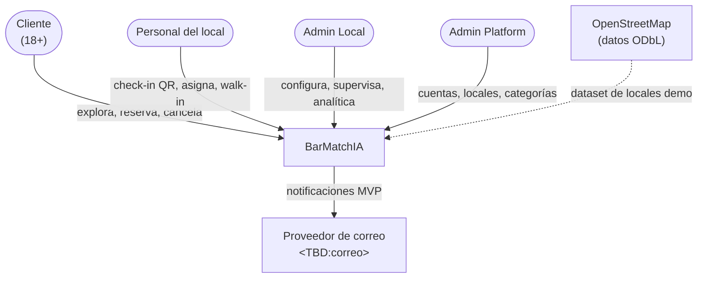
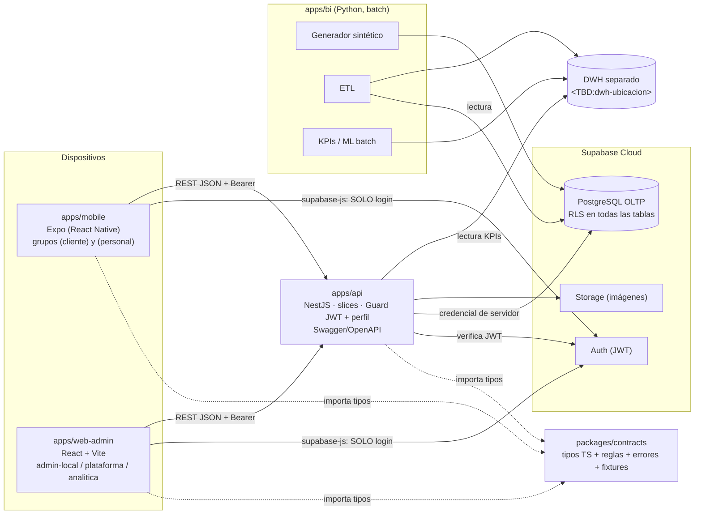

# 5.1 Arquitectura de la solución

> **Fuente:** Matriz final de alineamiento (PO, 02/10/2026) y CONTEXTO_IA §2–§3, §8, §10–§11.

## 5.1.1 Estilo arquitectónico

- **Cliente–servidor en tres niveles:** apps (móvil y web) → API NestJS → servicios gestionados de Supabase (PostgreSQL, Auth, Storage).
- **Vertical Slice Architecture (VSA):** el código se organiza por **funcionalidad** (`features/reservas`, `features/checkin`…) y no por capa técnica. Cada *slice* contiene su UI, hooks, acceso a datos y tipos. Se eligió para que el revisor manual (PO) pueda auditar una carpeta autocontenida sin saltar entre capas.
- **Puertos y adaptadores en el acceso a datos:** cada slice define una interfaz (*puerto*) y dos implementaciones (*adaptadores*): `http` (API real) y `mock` (memoria). Un proveedor de inyección elige cuál usar con una variable de entorno. Esto permitió desarrollar el frontend completo sin esperar al backend.
- **Analítica desacoplada (batch):** el pipeline de BI/IA lee el OLTP en modo solo lectura y escribe en un DWH separado; nunca participa en una transacción de reserva.

## 5.1.2 Diagrama de contexto

## 5.1.3 Diagrama de contenedores

## 5.1.4 Componentes

| Componente | Responsabilidad | Dueño |
|---|---|---|
| `apps/mobile` | Cliente: explorar, disponibilidad, reservar, QR, mis reservas, cancelar. Personal: panel −2/+2 h con *polling*, escáner QR, búsqueda manual, asignación, atenciones, walk-in. | Daniel |
| `apps/web-admin` | Admin Local: selector de local, reservas con filtros y paginación, configuración, MFA, analítica. Admin Platform: consola global. | Daniel (analítica: Josefa) |
| `apps/api` | Reglas de negocio, transacciones, autorización por perfil y pertenencia, catálogo de errores, OpenAPI. | Raúl |
| `packages/contracts` | Fuente única de DTOs, enumeraciones (espejo del DDL), constantes `REGLAS_R1`, errores y *fixtures* compartidos. | Daniel redacta, Raúl aprueba |
| `apps/bi` | Generador sintético reproducible, ETL, modelo estrella, KPIs y predicciones batch. | Josefa (ML con Raúl) |
| Supabase | PostgreSQL (fuente de verdad), Auth, Storage. | Raúl |

## 5.1.5 Comunicación entre servicios

| Origen → Destino | Protocolo | Autenticación | Notas |
|---|---|---|---|
| App/Web → Supabase Auth | HTTPS (supabase-js) | Correo + contraseña (MFA en perfiles admin) | Único uso de supabase-js en apps. |
| App/Web → API | HTTPS, REST/JSON, base `/api` | `Authorization: Bearer <JWT de Supabase>` | Endpoints públicos solo para exploración y disponibilidad. |
| API → PostgreSQL | Conexión TCP con credencial de servidor | Variable `DATABASE_URL` solo en servidor | Transacciones para reservas, check-in, asignación. |
| BI → PostgreSQL | SQL de solo lectura | Credencial distinta a la API | Nunca escribe en el OLTP (salvo el generador sintético en entornos de prueba). |
| API → DWH / JSON de KPIs | Lectura | Credencial de solo lectura | `GET /admin/analitica/kpis`. |
| Panel Personal → API | *Polling* cada 15–30 s (20 s por defecto) | Bearer | Realtime/WebSocket queda como evolución. |

**Contrato de API.** Endpoints del ciclo central (CONTEXTO_IA §7.1): `GET /me`, `GET /establecimientos`, `GET /establecimientos/:id`, `GET /establecimientos/:id/disponibilidad`, `POST /reservas`, `GET /reservas/mias`, `GET /reservas/:codigo_reserva`, `POST /reservas/:codigo_reserva/cancelar`, `GET /operacion/reservas`, `GET /operacion/reservas/buscar`, `POST /operacion/checkin`, `GET /admin/reservas`, `GET /admin/analitica/kpis`.
> **En transición (KAN-93, Minuta 13/10):** el backend pasa a ser la referencia del contrato (`camelCase`, IDs como texto, error `{ statusCode, codigo, message }`). ⚠️ **Validar Raúl** antes de la entrega final.

## 5.1.6 Decisión clave: consistencia de capacidad (anti-sobreventa)

**Problema.** Dos clientes confirman el último cupo de un bloque al mismo tiempo. Si ambos leen "hay 1 cupo" antes de que el otro escriba, se crean dos reservas → sobreventa (*condición de carrera*).

**Solución (Matriz #3).** PostgreSQL es la fuente de verdad. `POST /reservas` corre en **una transacción** que:
1. Toma `pg_advisory_xact_lock` sobre la clave **establecimiento + fecha** (un candado que solo una transacción puede tener a la vez; se libera solo al terminar la transacción).
2. Revalida la capacidad de todos los bloques que ocupa la reserva según `duracion_referencia_min`.
3. Inserta `reserva` y su `evento_reserva` (`CREADA`/`CONFIRMADA`), o responde `SIN_CAPACIDAD` (409).

Se descartó Redis para consistencia: agregaría una segunda fuente de verdad que puede desincronizarse con PostgreSQL. El mismo patrón aplica a asignación de mesas (R-12) y walk-in (R-13).

## 5.1.7 Registro de decisiones (resumen)

> Los ADR formales están asignados a Josefa (**KAN-50, J-14**). Esta tabla es el índice; no reemplaza los ADR.

| # | Decisión | Alternativa descartada | Motivo |
|---|---|---|---|
| ADR-001 | NestJS + PostgreSQL/Auth/Storage en Supabase | FastAPI + PostgreSQL propio en VPS | Menos infraestructura que operar para 3 personas; Auth gestionado. |
| ADR-002 | Revalidación atómica en PostgreSQL | Locks atómicos en Redis | Una sola fuente de verdad. |
| ADR-003 | Expo (React Native) para Cliente y Personal | PWA SvelteKit | Cámara nativa confiable para QR en tablets de gama baja. |
| ADR-004 | Web React + Vite para perfiles administrativos | Un solo *codebase* PWA | Paneles con tablas y gráficos densos. |
| ADR-005 | 4 perfiles (`CLIENTE`, `PERSONAL`, `ADMIN_LOCAL`, `ADMIN_PLATFORM`) | RBAC de 3 roles | Refleja el Mapa de Actores y RN-044. |
| ADR-006 | Polling 15–30 s en panel del Personal | WebSocket/SSE | Suficiente para el MVP y más simple de probar. |
| ADR-007 | IA batch precalculada, DWH separado | Inferencia en línea | No afecta el rendimiento transaccional. |
| ADR-008 | Docker solo para servicios propios | Dockerizar PostgreSQL/Auth | OLTP y Auth ya están en Supabase Cloud. |
| ADR-009 | Notificaciones MVP por correo + estado en app | Web Push (VAPID) | Menor alcance. |

## 5.1.8 Cambios respecto a la presentación EA1

La presentación de la Fase 1 mostraba FastAPI, SvelteKit (PWA), Redis, Caddy y VPS Hostinger. La **Matriz de alineamiento** (posterior y de mayor jerarquía) reemplazó ese stack por el descrito aquí. No es una inconsistencia: es un ajuste documentado del proyecto, que se informa como tal en el informe de avance.
