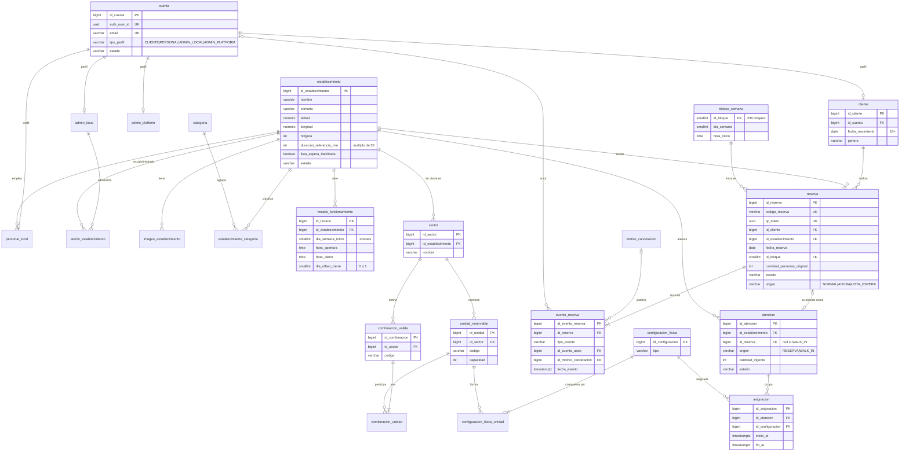
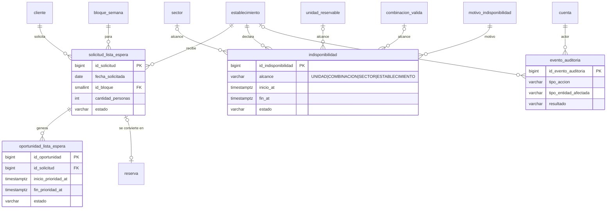
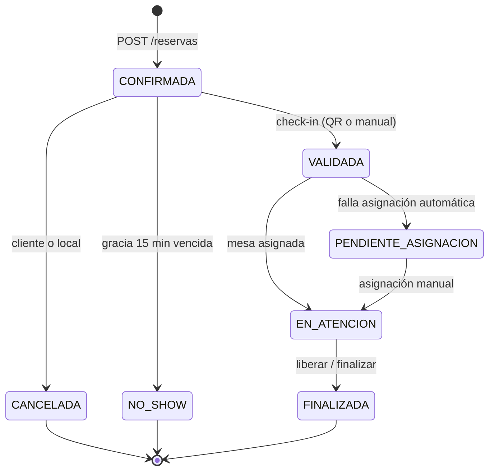
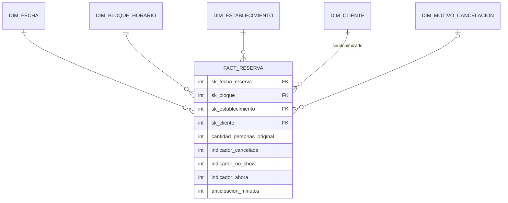

# 5.2 Modelo de datos

> **Fuente:** DDL PostgreSQL OLTP v1 (`BarMatchIA_PostgreSQL_ER_v1.sql`) y Diccionario de Datos OLTP — autor Raúl Guerra. Data Mart: Propuesta Preliminar Final — responsable Josefa Morales.
> Tipo de modelo: **Entidad–Relación clásico (SQL, PostgreSQL)**. 28 tablas + 1 vista en el OLTP.

## 5.2.1 Principios de diseño

1. **PostgreSQL es la fuente de verdad** de capacidad, reservas y estados.
2. **Separación de identidad y perfil:** `cuenta` (vinculada a Supabase Auth por `auth_user_id`) + una tabla por perfil (`cliente`, `personal_local`, `admin_local`, `admin_platform`).
3. **Tres identificadores de reserva:** `id_reserva` (interno, nunca se expone), `codigo_reserva` (legible) y `qr_token` (UUID, solo lo ve el cliente dueño).
4. **Historia por eventos:** cada cambio de estado de una reserva se registra en `evento_reserva` (actor, motivo, fecha). La cancelación tardía y el origen de la cancelación **se derivan** de estos eventos; no existen estados extra.
5. **Tiempo normalizado:** catálogo global `bloque_semana` de 336 bloques (7 días × 48 bloques de 30 min), `dia_semana` 1 = lunes … 7 = domingo, zona `America/Santiago`. La jornada nocturna se deriva de `horario_funcionamiento.dia_offset_cierre`.
6. **Integridad en la base:** restricciones `CHECK` para enumeraciones, rangos (latitud/longitud, `duracion_referencia_min` múltiplo de 30, `holgura ≥ 0`) y claves foráneas en todas las relaciones.
7. **Escalabilidad hacia analítica:** el modelo retiene historial completo (eventos y auditoría) para alimentar el DWH sin rediseño (mitiga el riesgo de *cold-start* del modelo predictivo).

## 5.2.2 Diagrama ER — núcleo (identidad, establecimiento, reserva y operación)

## 5.2.3 Diagrama ER — lista de espera, indisponibilidad y auditoría

**Vista `vw_capacidad_establecimiento`:** capacidad física (suma de unidades activas en sectores activos) menos `holgura` = capacidad reservable. ⚠️ Las vistas no respetan RLS por defecto: se crea con `security_invoker = on` o se revoca su acceso a `anon`/`authenticated` (CONTEXTO_IA §11).

## 5.2.4 Ciclo de estados de la reserva

> ⚠️ **Validar Raúl:** transiciones excepcionales (RN-005 validación anticipada, RN-008 llegada posterior al no-show, RN-023 resolución operacional) no se dibujan para mantener el diagrama legible.

## 5.2.5 Modelo analítico (Data Mart, preliminar)

> Responsable: **Josefa Morales**. Estado: propuesta preliminar final; ubicación física del DWH `<TBD:dwh-ubicacion>` (KAN-44). Este resumen no reemplaza su documento.

- **Separación física y de credenciales** respecto del OLTP; el ETL lee en modo solo lectura.
- **Hechos propuestos:** `FACT_RESERVA` (1 fila por reserva), `FACT_ATENCION`, `FACT_USO_FISICO`, `FACT_LISTA_ESPERA`, `FACT_INDISPONIBILIDAD`, `FACT_OPERACION_BLOQUE`.
- **Dimensiones:** `DIM_FECHA`, `DIM_BLOQUE_HORARIO`, `DIM_ESTABLECIMIENTO` (SCD tipo 2), `DIM_SECTOR`, `DIM_UNIDAD_RESERVABLE`, `DIM_CLIENTE`, `DIM_CATEGORIA`, `DIM_MOTIVO_CANCELACION`, `DIM_MOTIVO_INDISPONIBILIDAD`.
- **Privacidad (Matriz #25):** sin PII directa. `DIM_CLIENTE` solo con rango etario, género agregado y clave seudonimizada (hash con sal). `qr_token` no se traslada al Data Mart.

