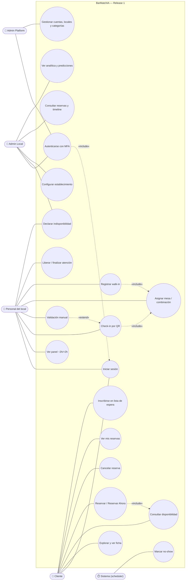
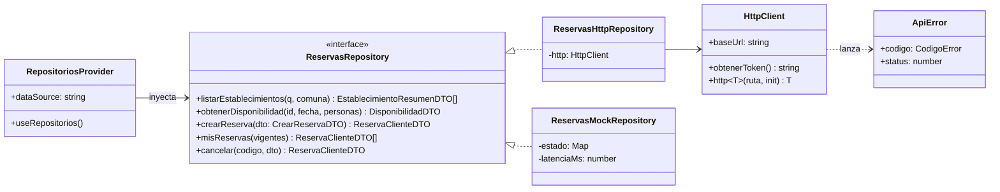
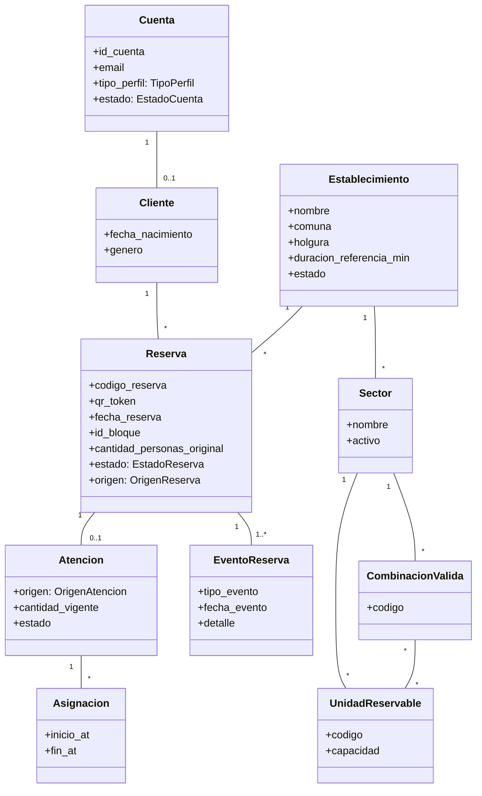
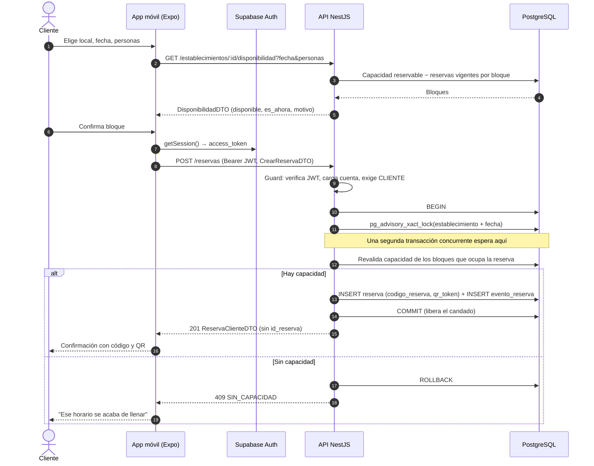
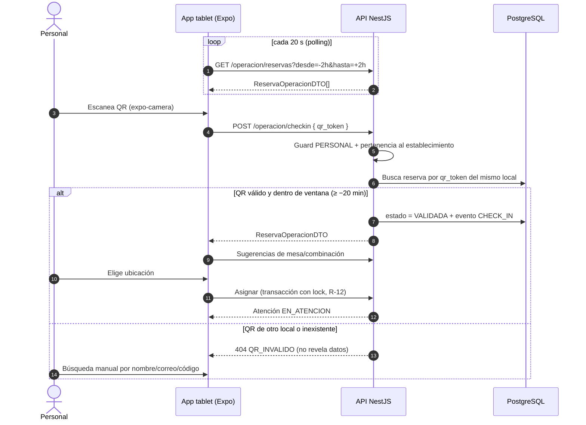
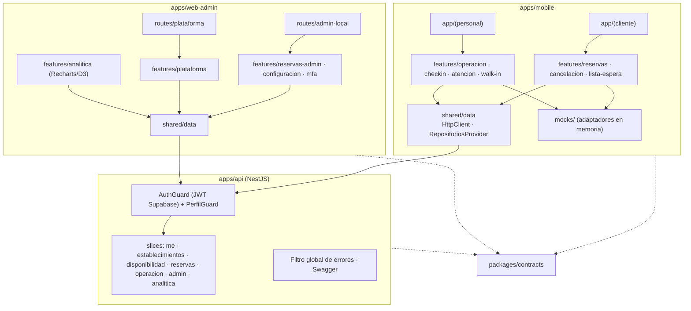

# 5.3 Diagramas UML mínimos

> Mermaid no tiene un tipo nativo de "casos de uso"; se representan con un *flowchart* usando la notación de actores y elipses.

## 5.3.1 Casos de uso

| Caso de uso | Actor | Brief | Estado (front / back) |
|---|---|---|---|
| UC2–UC6 | Cliente | 21.6.1, 21.6.2, 21.6.4, 21.6.15, 21.6.16 | Front ✅ / Back 🔄 |
| UC7 | Cliente | 21.6.3 | ⏳ Sprint 4 |
| UC8–UC13 | Personal | 21.6.6, 21.6.7, 21.6.8, 21.6.17 | Front ✅ / Back ⏳ |
| UC14 | Personal, Admin Local | 21.6.10 | ⏳ Sprint 4 |
| UC15–UC17, UC20 | Admin Local | 21.6.9, 21.6.11, 21.6.18, 21.6.13 | Front ✅ (mock) / Back ⏳ |
| UC18 | Admin Platform | 21.6.14, 21.6.19 | Scaffolding ✅ / Back ⏳ |
| UC19 | Sistema | 21.6.5 | ⏳ (`<TBD:scheduler>`) |

## 5.3.2 Diagrama de clases — acceso a datos en el frontend (puertos y adaptadores)

El mismo patrón se repite en cada slice (`OperacionRepository`, `AtencionRepository`, `AdminReservasRepository`). La suite de contrato de Jest corre contra ambos adaptadores: si las dos pasan, cambiar de `mock` a `api` es solo configuración.

## 5.3.3 Diagrama de clases — dominio de la reserva (simplificado)

## 5.3.4 Secuencia de la funcionalidad principal — crear reserva sin sobreventa

## 5.3.5 Secuencia — check-in por QR y asignación

## 5.3.6 Diagrama de componentes

