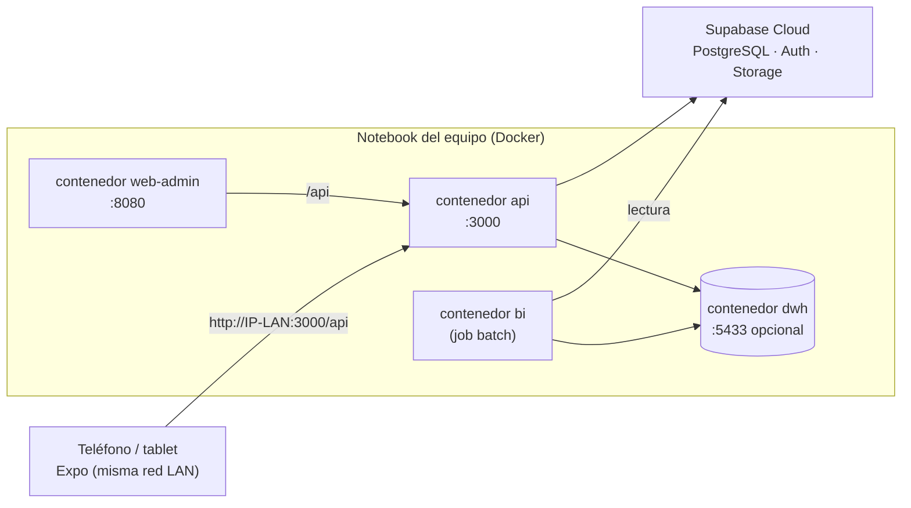

# 5.5 Diseño Docker

> **Decisión (Matriz #5, ADR-008):** PostgreSQL, Auth y Storage **ya están en Supabase Cloud**. Docker se usa **solo para servicios propios** cuando aporta reproducibilidad. No se duplica la base de datos en un contenedor para producción.
> ⚠️ **Validar contra el repo:** los cambios Docker se commitearon en KAN-60. Este documento describe el diseño; los archivos reales (`Dockerfile`, `docker-compose.yml`) del repositorio de desarrollo son la referencia y deben copiarse o enlazarse aquí antes de la entrega final.

## 5.5.1 ¿Qué es cada pieza? (para el equipo junior)

- **Imagen:** "foto" de un sistema con todo lo necesario para correr una app (sistema operativo mínimo + Node/Python + código).
- **Contenedor:** una imagen en ejecución, aislada del resto del computador.
- **Dockerfile:** la receta para construir una imagen.
- **docker-compose.yml:** archivo que levanta varios contenedores juntos, con sus variables y puertos.
- **Build multi-etapa:** se compila en una etapa "pesada" y se copia solo el resultado a una etapa final "liviana" (imagen más chica y con menos superficie de ataque).

## 5.5.2 Servicios y si se contenerizan

| Servicio | ¿Docker? | Motivo |
|---|---|---|
| `api` (NestJS) | Sí | Mismo runtime en todas las máquinas; base para despliegue. |
| `web-admin` (build estático React) | Sí | Se sirve como archivos estáticos (p. ej., con Nginx). |
| `bi` (ETL / ML batch, Python) | Sí | Fija versiones de pandas/scikit-learn; corre como *job*, no como servidor. |
| `dwh` (PostgreSQL de análisis) | Opcional, solo local | Mientras `<TBD:dwh-ubicacion>` no se decida (KAN-44). |
| `mobile` (Expo) | **No** | Se ejecuta en el dispositivo vía Expo Go o *build* nativo; contenerizar Metro no aporta. |
| PostgreSQL OLTP, Auth, Storage | **No** | Servicio gestionado en Supabase Cloud. |

## 5.5.3 Diagrama de despliegue local



## 5.5.4 Plantilla de referencia

> Plantilla didáctica para documentar y comparar con los archivos reales. **No reemplaza** el `docker-compose.yml` del repositorio de desarrollo.

```yaml
# docker-compose.yml (referencia)
# Levanta SOLO los servicios propios. La base OLTP, Auth y Storage viven en Supabase Cloud.
services:
  api:
    build:
      context: .                      # raíz del monorepo: la API necesita packages/contracts
      dockerfile: apps/api/Dockerfile
    env_file: apps/api/.env           # DATABASE_URL, SUPABASE_URL, JWKS... (nunca se commitea)
    environment:
      API_DATA_MODE: db               # 'memory' para demo sin base de datos
    ports:
      - "3000:3000"                   # host:contenedor
    restart: unless-stopped

  web-admin:
    build:
      context: .
      dockerfile: apps/web-admin/Dockerfile
      args:                           # Vite "hornea" estas variables en el build (son públicas)
        VITE_API_URL: http://localhost:3000
        VITE_DATA_SOURCE: api
    ports:
      - "8080:80"
    depends_on: [api]

  bi:
    build: ./apps/bi
    env_file: apps/bi/.env            # credencial de SOLO LECTURA al OLTP + credencial del DWH
    profiles: ["batch"]               # no arranca con 'up'; se ejecuta con: docker compose run --rm bi
```

```dockerfile
# apps/api/Dockerfile (referencia, build multi-etapa)
FROM node:<TBD:version-node>-alpine AS build
WORKDIR /repo
RUN corepack enable                                  # activa pnpm con la versión de packageManager
COPY pnpm-lock.yaml pnpm-workspace.yaml package.json ./
COPY packages/contracts packages/contracts
COPY apps/api apps/api
RUN pnpm install --frozen-lockfile --filter api... \
 && pnpm --filter @barmatchia/contracts build \
 && pnpm --filter api build

FROM node:<TBD:version-node>-alpine AS runtime
WORKDIR /app
ENV NODE_ENV=production
COPY --from=build /repo/apps/api/dist ./dist
COPY --from=build /repo/node_modules ./node_modules
USER node                                            # no correr como root
EXPOSE 3000
CMD ["node", "dist/main.js"]
```

## 5.5.5 Buenas prácticas aplicadas

- Secretos por `env_file`, nunca en la imagen ni en el compose versionado.
- Usuario sin privilegios (`USER node`) en la imagen final.
- `--frozen-lockfile`: el build falla si el lockfile no coincide (dependencias reproducibles).
- `.dockerignore` con `node_modules`, `.env`, `dist`, `.git`.
- El servicio `bi` corre como *job* (perfil `batch`), alineado con la decisión de IA batch.
