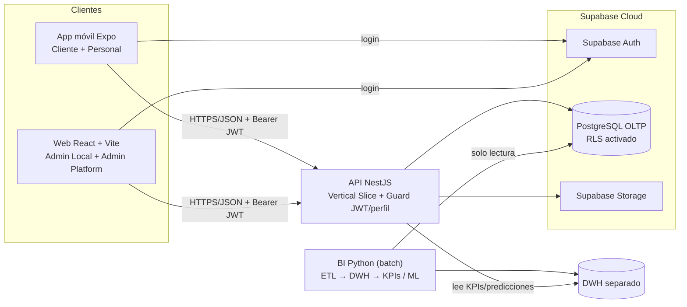

# BarMatchIA — Evidencias de documentación (Proyecto APT)

> Esta carpeta reúne las evidencias documentales del Proyecto APT (Capstone PTY4614, DuocUC), dentro de `03Proyecto/Evidencias de documentación/`. Se prepara para su publicación en el repositorio académico, separado del repositorio de desarrollo `barmatchia-mvp`. Los documentos reflejan distintos cortes de avance; la presencia de un archivo no implica que todas sus funcionalidades estén implementadas.

| Campo | Valor |
|---|---|
| Versión de la documentación | Corte de organización: 19/10/2026; documentos con fechas propias |
| Fuente normativa | Matriz final de alineamiento (PO, 02/10/2026) > RN 21.11 > DDL OLTP actual (cuando corresponda) > Propuesta Data Mart > briefs 21.6.x > Documento Maestro v0.2.1 |
| Gestión del trabajo | Jira, proyecto `KAN` (sitio `duocuc-team-tbw1x9z5.atlassian.net`) |
| Repositorio de código | `<TBD:url-repo-desarrollo>` |

---

## 1. Nombre del proyecto

**BarMatchIA** — plataforma B2B2C de descubrimiento, reserva y gestión operacional de bares y locales nocturnos en Chile, con una capa de analítica e inteligencia artificial (IA) desacoplada de la operación transaccional.

## 2. Descripción

**Qué hace.** Permite que un cliente descubra establecimientos, consulte disponibilidad real por bloques de 30 minutos, reserve y llegue con un código QR; permite que el personal del local valide la llegada (check-in) y gestione la atención; y entrega al administrador del local una vista de sus reservas y analítica operacional.

**A quién va dirigido.**
- **B2C (usuario final):** personas de 18+ años que planifican salidas a bares (perfil `CLIENTE`).
- **B2B (cliente pagante):** bares, pubs y locales nocturnos pequeños y medianos (perfiles `PERSONAL`, `ADMIN_LOCAL`).
- **Operación de la plataforma:** perfil `ADMIN_PLATFORM`.

**Qué problema resuelve.** Información **fragmentada** para el cliente (¿dónde voy?, ¿habrá espacio?, ¿cómo aseguro mi lugar?) e información **desaprovechada** para el establecimiento (reservas, ocupación y no-shows que se usan solo para operar la noche y nunca se convierten en conocimiento para decidir).

## 3. Tecnologías utilizadas

| Capa | Tecnología | Para qué se usa |
|---|---|---|
| App móvil (Cliente + Personal) | Expo (React Native), expo-router, TanStack Query, expo-camera | Una sola app con dos grupos de rutas por perfil; cámara nativa para leer QR |
| Web (Admin Local + Admin Platform) | React + Vite, React Router, TanStack Query | Paneles administrativos en navegador |
| API | NestJS (TypeScript) — ORM `<TBD:orm>` (en curso, KAN-35) | Única puerta de acceso a los datos; reglas de negocio y autorización |
| Base de datos | PostgreSQL en **Supabase Cloud** | Fuente de verdad transaccional (OLTP) |
| Autenticación | Supabase Auth (JWT) | Login y emisión de tokens; la API valida el token y el perfil |
| Archivos | Supabase Storage | Imágenes de establecimientos (`storage_key` en PostgreSQL) |
| BI / IA | Python (pandas, numpy, scikit-learn), SQL; gráficos con Recharts / D3 | ETL batch → Data Warehouse separado → KPIs y predicciones precalculadas |
| Contratos compartidos | `packages/contracts` (tipos TypeScript + fixtures) | Permite trabajar en paralelo front/back con mocks |
| Calidad | Jest (TypeScript), pytest + ruff (Python), Husky + lint-staged, CI | Pruebas automáticas y control previo al commit |
| Contenedores | Docker / Docker Compose (solo servicios propios) | Reproducibilidad del entorno |
| Gestión | Jira (Scrum), Git/GitHub, Figma | Backlog, control de versiones, prototipos |

> **Glosario rápido:** *OLTP* = base de datos de operación diaria; *DWH* = Data Warehouse (base separada para análisis); *ETL* = Extraer-Transformar-Cargar; *JWT* = token firmado que prueba quién es el usuario; *RLS* = Row Level Security, permisos por fila en PostgreSQL; *RBAC* = control de acceso por roles.

## 4. Instrucciones para ejecutar el proyecto localmente

El procedimiento documentado se encuentra en el [Manual técnico y de despliegue](00BarMatchIA_MarcoAgil/08_manual_tecnico.md). Los comandos siguientes provienen del borrador técnico y **requieren validación contra el repositorio de desarrollo** antes de considerarse instrucciones definitivas:

```bash
# 1. Requisitos: Node.js (versión fijada en .nvmrc), pnpm (versión fijada en packageManager), Docker, Python 3.x
git clone <TBD:url-repo-desarrollo> barmatchia-mvp && cd barmatchia-mvp
pnpm install                 # instala todo el monorepo desde la raíz
pnpm approve-builds          # pnpm bloquea scripts de instalación por seguridad; aquí se aprueban los necesarios
pnpm contracts:build         # compila packages/contracts (lo usan app, web y API)

# 2. Variables de entorno: copiar cada .env.example a .env y completar (ver manual)

# 3. Levantar
pnpm --filter mobile start   # app Expo (Cliente / Personal)
pnpm --filter web-admin dev  # web (Admin Local / Admin Platform)
docker compose up -d         # servicios propios dockerizados (ver manual)
```

## 5. Integrantes del equipo y roles

| Integrante | Rol técnico | Rol Scrum |
|---|---|---|
| Raúl Guerra Gutiérrez | Backend (NestJS, Supabase, modelo OLTP) | **Product Owner** y revisor manual de código |
| Josefa Morales Jiménez | BI (DWH, modelo estrella, ETL, analítica) e IA compartida | **Scrum Master** |
| Daniel Godfray Abatte | Frontend (app móvil y web), QA y CI | Development Team |

## 6. Metodología de trabajo

**Scrum** adaptado a un equipo de 3 personas con disponibilidad nocturna (20:00–00:00), con prácticas **DevSecOps** (seguridad y pruebas integradas al flujo de desarrollo, no al final):

- Sprints cortos alineados a hitos académicos (informe de avance 16/10, informe final 20/11, presentación 04/12/2026).
- Reunión semanal de avance con minuta y seguimiento escrito en Jira.
- Trabajo paralelo por **contratos de API** (`packages/contracts`) + adaptadores *mock*, para que el frontend no se bloquee por el backend.
- Un *slice* (funcionalidad vertical) por *pull request* (PR), Conventional Commits y revisión cruzada obligatoria.
- Definición de Terminado (DoD) explícita: ver [Definition of Done](00BarMatchIA_MarcoAgil/04_definition_of_done.md).

## 7. Arquitectura de la solución

Detalle en [00BarMatchIA_MarcoAgil/05_diseno/01_arquitectura.md](00BarMatchIA_MarcoAgil/05_diseno/01_arquitectura.md).



---

## Mapa de este repositorio (Anexo "Artefactos y Documentos Solicitados por Metodología")

| # | Artefacto exigido (opción Marco Ágil) | Archivo |
|---|---|---|
| 1 | Product Vision | [00BarMatchIA_MarcoAgil/01_product_vision.md](00BarMatchIA_MarcoAgil/01_product_vision.md) |
| 2 | Product Backlog priorizado | [00BarMatchIA_MarcoAgil/02_product_backlog.md](00BarMatchIA_MarcoAgil/02_product_backlog.md) |
| 3 | Sprint Backlog (por sprint) | [00BarMatchIA_MarcoAgil/03_sprint_backlog/](00BarMatchIA_MarcoAgil/03_sprint_backlog/README.md) |
| 4 | Definition of Done | [00BarMatchIA_MarcoAgil/04_definition_of_done.md](00BarMatchIA_MarcoAgil/04_definition_of_done.md) |
| 5 | Documento de diseño | [00BarMatchIA_MarcoAgil/05_diseno/](00BarMatchIA_MarcoAgil/05_diseno/README.md) |
| 6 | Evidencia de retrospectivas | [00BarMatchIA_MarcoAgil/06_retrospectivas/](00BarMatchIA_MarcoAgil/06_retrospectivas/README.md) |
| 7 | Plan de pruebas + evidencias | [00BarMatchIA_MarcoAgil/07_pruebas/](00BarMatchIA_MarcoAgil/07_pruebas/README.md) |
| 8 | Manual técnico / despliegue | [00BarMatchIA_MarcoAgil/08_manual_tecnico.md](00BarMatchIA_MarcoAgil/08_manual_tecnico.md) |

| Elemento obligatorio (independiente de la metodología) | Dónde está |
|---|---|
| Arquitectura | `00BarMatchIA_MarcoAgil/05_diseno/01_arquitectura.md` |
| Modelo de datos | `00BarMatchIA_MarcoAgil/05_diseno/02_modelo_datos.md` |
| Diagramas UML mínimos | `00BarMatchIA_MarcoAgil/05_diseno/03_uml.md` |
| Requisitos no funcionales | `00BarMatchIA_MarcoAgil/05_diseno/04_requisitos_no_funcionales.md` |
| Docker | `00BarMatchIA_MarcoAgil/05_diseno/05_docker.md` + `00BarMatchIA_MarcoAgil/08_manual_tecnico.md` |
| Pruebas | `00BarMatchIA_MarcoAgil/07_pruebas/` |
| Innovación | `00BarMatchIA_MarcoAgil/09_innovacion.md` |
| Mapa hacia los informes de avance y final (guías 2.3, 2.4, 2.6) | `00BarMatchIA_MarcoAgil/10_mapa_informes_apt.md` |

> **Convención de marcadores:** todo valor aún no decidido por el equipo aparece como `<TBD:tema>`. No se rellena con supuestos. Los textos marcados con **⚠️ Validar** requieren confirmación del responsable indicado antes de la entrega final.

---

## Evidencias complementarias de esta carpeta

| Carpeta | Material disponible en el paquete del 19/10/2026 |
|---|---|
| [`00BarMatchIA_MarcoAgil/`](00BarMatchIA_MarcoAgil/) | Artefactos Scrum, diseño, UML, RNF, Docker documentado, retrospectivas, pruebas documentadas, manual e innovación; varios archivos son borradores con pendientes de validación. |
| `01BarMatchIA_Arquitectura/` | Carpeta reservada para evidencias visuales complementarias de arquitectura; vacía en este corte. La descripción técnica existente está en `00BarMatchIA_MarcoAgil/05_diseno/01_arquitectura.md`. |
| [`02BarMatchIA_ModeloDeDatos/`](02BarMatchIA_ModeloDeDatos/) | [Diagrama ER en PDF](02BarMatchIA_ModeloDeDatos/BarMatchIA_OLTP_ER_20261019.pdf) y [modelo ER interactivo en HTML](02BarMatchIA_ModeloDeDatos/BarMatchIA_OLTP_ER_Interactivo20261019.html). Su fidelidad al DDL debe verificarse antes del cierre definitivo. |
| [`03BarMatchIA_Mockups/`](03BarMatchIA_Mockups/) | Mockup global HTML del MVP. |
| `04BarMatchIA_RNF/` | Carpeta reservada, vacía; los RNF documentados están en `00BarMatchIA_MarcoAgil/05_diseno/04_requisitos_no_funcionales.md`. |
| `05BarMatchIA_Docker/` | Carpeta reservada, vacía; el diseño documental está en `00BarMatchIA_MarcoAgil/05_diseno/05_docker.md`. |
| `06BarMatchIA_Pruebas/` | Carpeta reservada, vacía; el plan y los borradores de evidencias están en `00BarMatchIA_MarcoAgil/07_pruebas/`. |
| `07BarMatchIA_Innovacion/` | Carpeta reservada, vacía; el texto de innovación está en `00BarMatchIA_MarcoAgil/09_innovacion.md`. |
| [`08BarMatchIA_ReglasDeNegocio/`](08BarMatchIA_ReglasDeNegocio/) | Reglas de negocio, mapa de actores y responsabilidades y 19 briefs de flujos de usuario. |

Las evidencias audiovisuales de los perfiles de aplicación y la presentación están **fuera de esta carpeta**, bajo `03Proyecto/Evidencias de sistema aplicacion/` y `03Proyecto/Presentacion Proyecto.pptx`. Los documentos individuales y grupales pertenecen a `01Individuales/` y `02Grupales/`, respectivamente.

**Estado documental:** esta carpeta combina entregables existentes, borradores sujetos a revisión y contenedores reservados para próximas evidencias. Ninguna carpeta vacía debe interpretarse como un artefacto completado.
