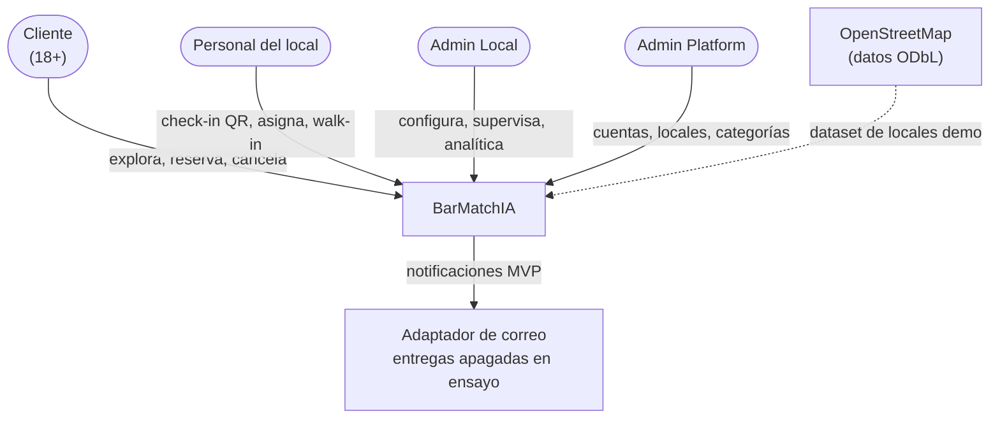
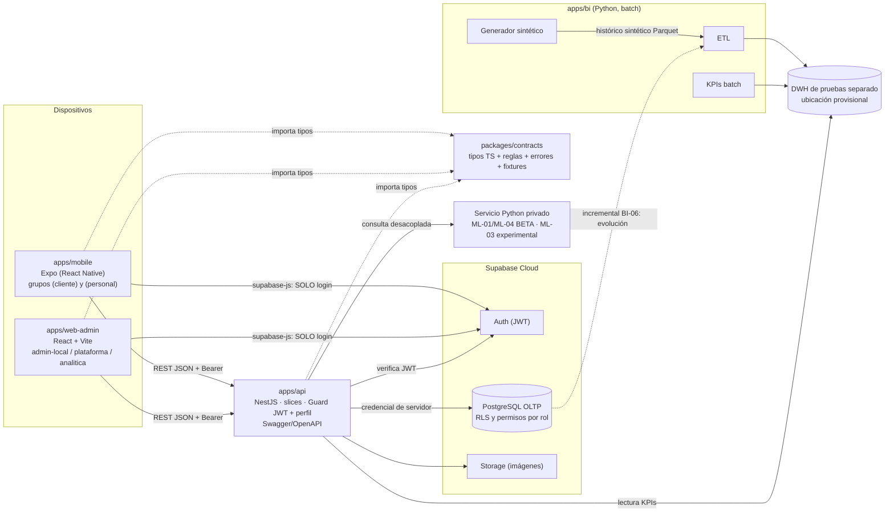

# 5.1 Arquitectura de la solución

> **Corte:** MVP1 al 15/11/2026, contrastado con `develop` (`99056d0`) el 25/11. Requisitos de la Matriz y RN; implementación y validación según [fuentes de cierre](../../README.md#fuentes-y-alcance).

## 5.1.1 Estilo arquitectónico

- **Cliente–servidor en tres niveles:** apps (móvil y web) → API NestJS → servicios gestionados de Supabase (PostgreSQL, Auth, Storage).
- **Vertical Slice Architecture (VSA):** el código se organiza por **funcionalidad** (`features/reservas`, `features/checkin`…) y no por capa técnica. Cada *slice* contiene su UI, hooks, acceso a datos y tipos. Se eligió para que el revisor manual (PO) pueda auditar una carpeta autocontenida sin saltar entre capas.
- **Puertos y adaptadores en el acceso a datos:** cada slice define una interfaz (*puerto*) y dos implementaciones (*adaptadores*): `http` (API real) y `mock` (memoria). Un proveedor de inyección elige cuál usar con una variable de entorno. Esto permitió desarrollar el frontend completo sin esperar al backend.
- **Analítica desacoplada (batch):** BI dispone de ETL y DWH de pruebas separado del OLTP de la aplicación. BI-03 cargó histórico Parquet sintético y la API consulta KPI del DWH. El incremental en vivo es evolución BI-06. La Inteligencia usa un servicio Python privado separado; nunca participa en la transacción de reserva.

## 5.1.2 Diagrama de contexto

## 5.1.3 Diagrama de contenedores

## 5.1.4 Componentes

| Componente | Responsabilidad | Dueño |
|---|---|---|
| `apps/mobile` | Cliente: explorar, disponibilidad, reservar, QR, mis reservas, cancelar. Personal: panel −2/+2 h con *polling*, escáner QR, búsqueda manual, asignación, atenciones, walk-in. | Daniel |
| `apps/web-admin` | Admin Local: selector de local, reservas con filtros y paginación, configuración, MFA, analítica. Admin Platform: consola global. | Daniel (analítica: Josefa) |
| `apps/api` | Reglas de negocio, transacciones, autorización por perfil y pertenencia, catálogo de errores, OpenAPI. | Raúl |
| `packages/contracts` | Fuente única de DTOs, enumeraciones (espejo del DDL), constantes `REGLAS_R1`, errores y *fixtures* compartidos. | Daniel redacta, Raúl aprueba |
| `apps/bi` | Generador sintético, ETL, modelo estrella y KPI. Inteligencia se documenta como servicio separado; no se confunde con el pipeline KPI. | Josefa (ML con Raúl) |
| Supabase | PostgreSQL (fuente de verdad), Auth, Storage. | Raúl |

## 5.1.5 Comunicación entre servicios

| Origen → Destino | Protocolo | Autenticación | Notas |
|---|---|---|---|
| App/Web → Supabase Auth | HTTPS (supabase-js) | Correo + contraseña (MFA en perfiles admin) | Único uso de supabase-js en apps. |
| App/Web → API | HTTPS, REST/JSON, base `/api` | `Authorization: Bearer <JWT de Supabase>` | Endpoints públicos solo para exploración y disponibilidad. |
| API → PostgreSQL | Conexión TCP con credencial de servidor | Variable `DATABASE_URL` solo en servidor | Transacciones para reservas, check-in, asignación. |
| BI → PostgreSQL | SQL de solo lectura | Credencial distinta a la API | Nunca escribe en el OLTP (salvo el generador sintético en entornos de prueba). |
| API → DWH / JSON de KPIs | Lectura | Credencial de solo lectura | `GET /admin/analitica/kpis`, validado con DWH de pruebas. |
| Panel Personal → API | *Polling* cada 15–30 s (20 s por defecto) | Bearer | Realtime/WebSocket queda como evolución. |

**Contrato de API.** Endpoints del ciclo central (CONTEXTO_IA §7.1): `GET /me`, `GET /establecimientos`, `GET /establecimientos/:id`, `GET /establecimientos/:id/disponibilidad`, `POST /reservas`, `GET /reservas/mias`, `GET /reservas/:codigo_reserva`, `POST /reservas/:codigo_reserva/cancelar`, `GET /operacion/reservas`, `GET /operacion/reservas/buscar`, `POST /operacion/checkin`, `GET /admin/reservas`, `GET /admin/analitica/kpis`.
> **Contrato de cierre:** los adaptadores HTTP se integraron con las respuestas reales, `camelCase`, identificadores según cada contrato y errores `{ statusCode, codigo, message }`. El OpenAPI y los contratos del repositorio privado son la referencia; la enumeración anterior es una vista del ciclo, no un catálogo exhaustivo ni una interfaz nueva. El cierre técnico no certifica el estado Jira de KAN-93.

## 5.1.6 Decisión clave: consistencia de capacidad (anti-sobreventa)

**Problema.** Dos clientes confirman el último cupo de un bloque al mismo tiempo. Si ambos leen "hay 1 cupo" antes de que el otro escriba, se crean dos reservas → sobreventa (*condición de carrera*).

**Solución implementada.** El Motor compartido coordina disponibilidad, reservas y operación. PostgreSQL conserva la fuente de verdad, con bloqueo transaccional por establecimiento, relectura del estado, evaluación de factibilidad física mediante solver y confirmación atómica en la misma transacción. No basta sumar asientos: se consideran unidades, combinaciones y ocupación real. Los eventos y controles de idempotencia forman parte de la operación transaccional.

La auditoría del cierre verificó 50, 100 y 200 solicitudes simultáneas sobre el último cupo: una confirmada, cero sobreventas. Con una misma clave de idempotencia, 100 envíos produjeron una reserva. Son resultados del entorno de laboratorio auditado, no una capacidad productiva comprometida.

Redis no se utiliza como fuente de consistencia. El cierre distingue código y laboratorios de jobs, proveedores y entregas, cuya activación operacional requiere autorización. El ADR y las actas del Motor contienen estados de distintas fechas: no se extrapola un estado histórico de despliegue al conjunto del MVP1.

## 5.1.7 Registro de decisiones (resumen)

> Resumen de decisiones del documento original: los identificadores de esta tabla son locales y no acreditan ADR formales ni cierre de KAN-50. El ADR-001 de BI sí existe y fue enmendado en PR #176; el ADR del Motor tiene su propia evolución. Ver [fuentes](../../README.md#fuentes-y-alcance).

| # | Decisión | Alternativa descartada | Motivo |
|---|---|---|---|
| ADR-001 | NestJS + PostgreSQL/Auth/Storage en Supabase | FastAPI + PostgreSQL propio en VPS | Menos infraestructura que operar para 3 personas; Auth gestionado. |
| ADR-002 | Revalidación atómica en PostgreSQL | Locks atómicos en Redis | Una sola fuente de verdad. |
| ADR-003 | Expo (React Native) para Cliente y Personal | PWA SvelteKit | Cámara nativa confiable para QR en tablets de gama baja. |
| ADR-004 | Web React + Vite para perfiles administrativos | Un solo *codebase* PWA | Paneles con tablas y gráficos densos. |
| ADR-005 | 4 perfiles (`CLIENTE`, `PERSONAL`, `ADMIN_LOCAL`, `ADMIN_PLATFORM`) | RBAC de 3 roles | Refleja el Mapa de Actores y RN-044. |
| ADR-006 | Polling del panel y notificaciones desacopladas | Canal único para todo | El Motor incorpora bandeja/eventos; no se afirma que el polling excluya otros canales implementados. |
| ADR-007 | KPI batch en DWH y servicio de Inteligencia separado | Acoplar ML a confirmación de reservas | Una dependencia experimental no bloquea la operación crítica. |
| ADR-008 | Docker para laboratorios y reproducibilidad | Compose integral como despliegue acreditado | PostgreSQL/Auth desechables sí se usaron en QA; el Compose general sigue incompleto. |
| ADR-009 | Bandeja y adaptadores de notificación | Entrega externa asumida | Correo/entregas apagados en el ensayo; proveedor definitivo y activación son acciones separadas. |

## 5.1.8 Cambios respecto a la presentación EA1

La presentación de la Fase 1 mostraba FastAPI, SvelteKit (PWA), Redis, Caddy y VPS Hostinger. La **Matriz de alineamiento** (posterior y de mayor jerarquía) reemplazó ese stack por el descrito aquí. No es una inconsistencia: es un ajuste documentado del proyecto, que se informa como tal en el informe de avance.

## 5.1.9 Evidencia gráfica y alcance del cierre

El [diagrama publicado](../../01BarMatchIA_Arquitectura/ArquitecturaBarMatchIA_MVP.png) pertenece a una presentación anterior; se conserva íntegro y no se declara arquitectura final certificada. Los diagramas de este documento son vistas conceptuales de responsabilidades, no recetas de despliegue.

**MVP1 cumplido y validado:** integración funcional de app/web/API, controles del Motor, operación y BI con DWH de pruebas. **Limitaciones no bloqueantes:** hallazgos de endurecimiento y verificaciones físicas descritos en las actas. **Evolución/producción:** galería editable, BI incremental, supresión y hosting productivo. Detalle en [arquitectura de cierre](../../01BarMatchIA_Arquitectura/Arquitectura_BarMatchIA.md) y [pruebas](../07_pruebas/README.md).
